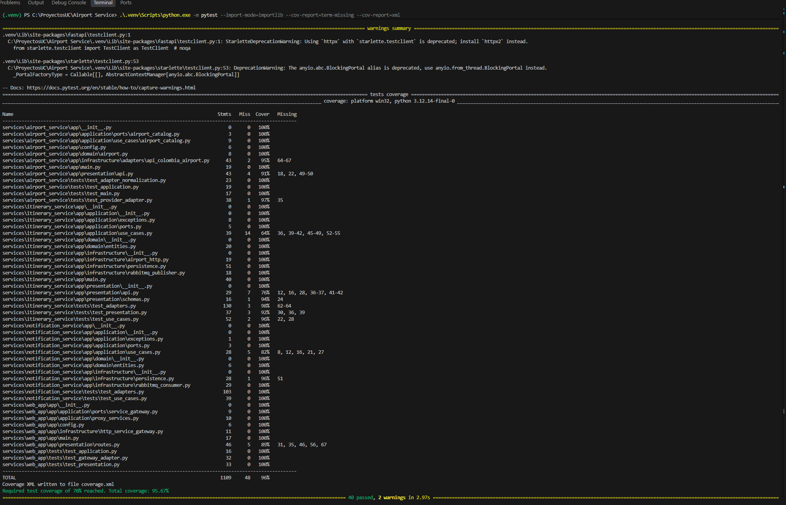

# Desarrollo local

## Inicio

1. Instalar Docker Desktop y Docker Compose.
2. Copiar `.env.example` como `.env` y cambiar las contraseñas locales.
3. Ejecutar `docker compose up --build`.
4. Aplicación web: `http://localhost:8000`.
5. Airport Service: `http://localhost:8001/docs`.
6. Itinerary Service: `http://localhost:8002/docs`.
7. RabbitMQ: `http://localhost:15672` con las credenciales definidas en `.env`.

## Calidad

- `pip install -e '.[dev]'`
- `python -m pytest --cov-report=xml`
- `ruff check services`
- `docker compose build`

### Evidencia de pruebas unitarias

Ejecución local del 9 de octubre de 2026: **40 pruebas aprobadas** y **95,67 % de cobertura**, por encima del mínimo configurado de 70 %. La ejecución mostró dos advertencias de obsolescencia de dependencias; no impidieron que las pruebas pasaran.

No almacenar credenciales, URLs productivas ni archivos `.tfstate` en Git.
