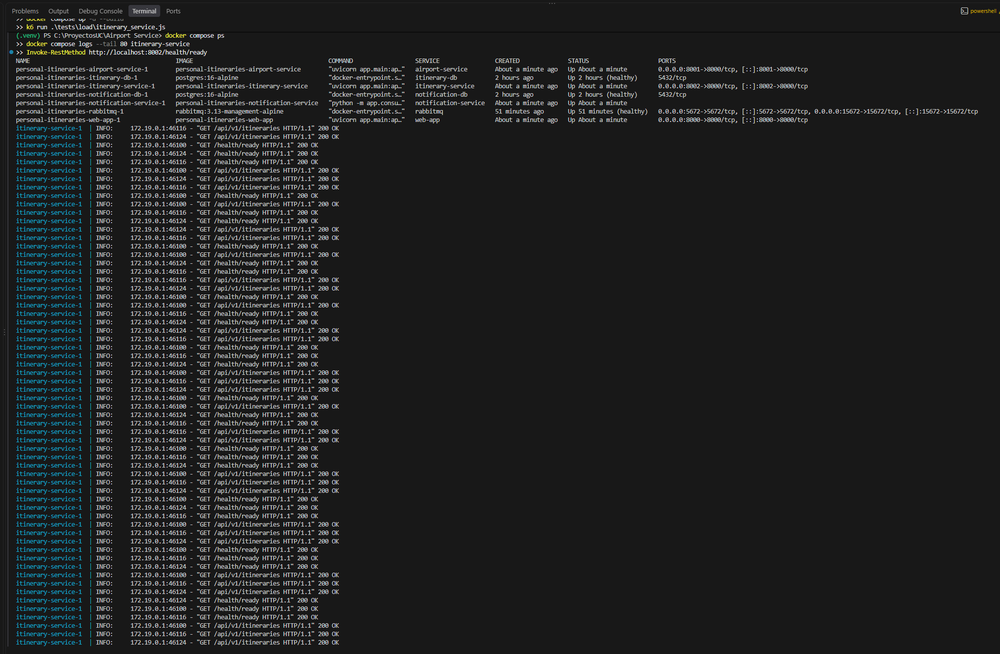
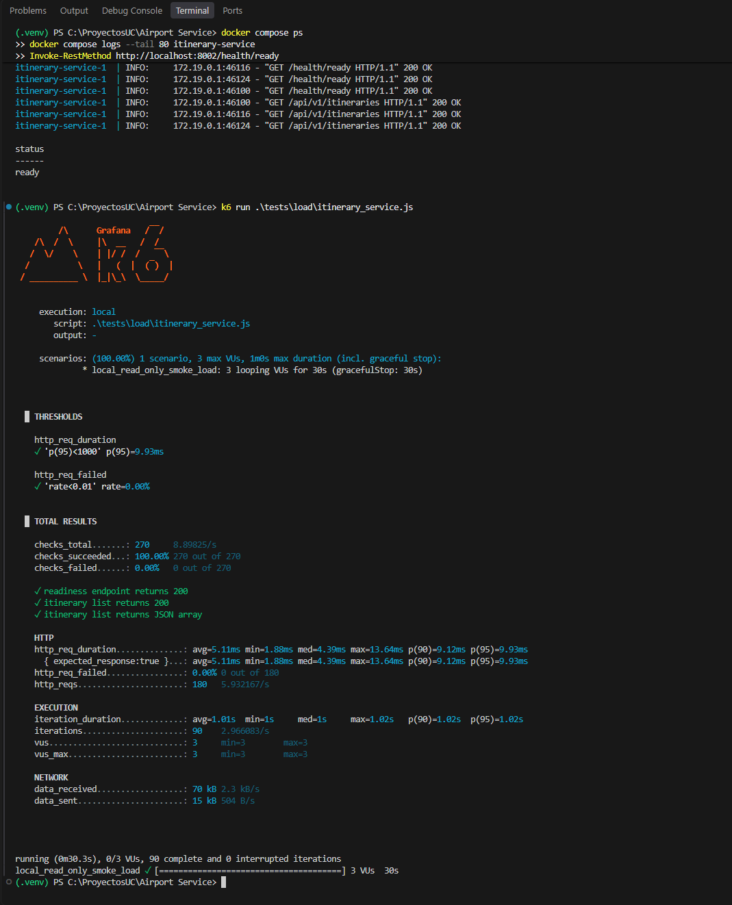

# Prueba de carga local

Este escenario de k6 genera tráfico bajo y de solo lectura contra Itinerary Service: consulta readiness y lista itinerarios. Usa tres usuarios virtuales durante 30 segundos y solo permite destinos `localhost` o `127.0.0.1`.

## Requisitos y ejecución

1. Inicia el entorno local completo desde la raíz del proyecto: `docker compose up -d --build`.
2. Instala k6 siguiendo la [guía oficial](https://grafana.com/docs/k6/latest/set-up/install-k6/). En Windows también puedes usar `winget install k6 --source winget`.
3. Ejecuta desde la raíz:

   ```powershell
   k6 run tests/load/itinerary_service.js
   ```

Itinerary Service debe estar disponible en `http://localhost:8002`. Para usar otro puerto local:

```powershell
$env:BASE_URL = "http://localhost:PUERTO"
k6 run tests/load/itinerary_service.js
Remove-Item Env:BASE_URL
```

El proceso termina con error si las solicitudes fallan, si la latencia p95 supera 1 segundo o si las respuestas no cumplen los checks. k6 también muestra métricas resumidas al finalizar.

## Evidencia de ejecución

Ejecución local del 9 de octubre de 2026: el servicio estaba listo antes de iniciar la prueba. Con 3 usuarios virtuales durante 30 segundos se completaron 90 iteraciones, 180 solicitudes y 270 checks. Pasaron los 270 checks; la tasa de solicitudes fallidas fue 0 % y p95 fue 9,93 ms, dentro del límite de 1 segundo.

La primera captura muestra los contenedores activos, el readiness en estado `ready` y las respuestas HTTP 200 registradas en los logs:



La segunda captura muestra los resultados de k6 y los umbrales aprobados:



## Uso seguro

- Ejecuta este escenario únicamente contra tu entorno local o un entorno de pruebas autorizado. El script rechaza URLs que no sean `localhost` o `127.0.0.1`.
- No lo apuntes a producción ni aumentes usuarios, duración o frecuencia sin autorización y una ventana de prueba acordada.
- El escenario no crea, modifica ni elimina itinerarios. La lista puede estar vacía y aun así la respuesta es válida.
